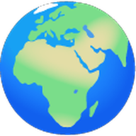
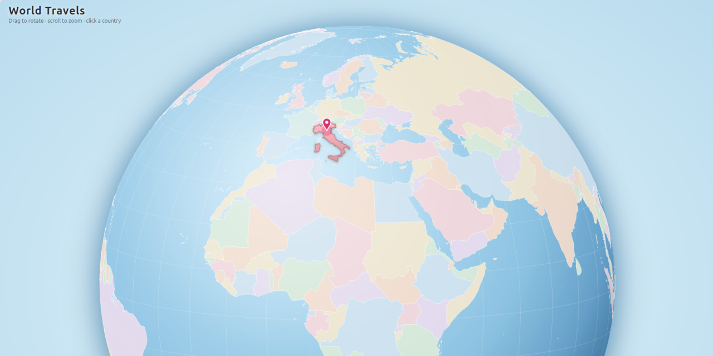

<p align="center"></p>

# World Travels

A static HTML page with a **rotating globe** and a **flat world map**. Drag to rotate (or pan), scroll to zoom, and click a country to see its name, flag, links to Wikipedia and Google Maps, and your own notes.

**Visited** countries (the ones that have a notes file) are highlighted with full colour, a gradient, a darker border and a 📍 pin; all other countries are light grey. The list of visited countries is in the bottom-left corner: click a name to centre the map on that country and open its popup.

The 🗺️/🌍 button in the bottom-right corner switches between the globe and the flat map, and the browser remembers your choice. You can also force a view from the URL with `index.html?view=globe` or `index.html?view=flat`.

## Screenshot



## Requirements

Only **Docker**. Python and its dependencies run inside a container (`python:3.12-slim`).

## Usage

```bash
./build.sh              # builds the example notes in this repo -> ./notes/index.html
./build.sh ~/my-travels # builds your own notes folder -> ~/my-travels/notes/index.html
```

Then open `notes/index.html` in your browser (a double click is enough, no server needed) and reload the page after each rebuild.

The notes shipped in this repo (`notes/IT.md`) are only an **example**. To keep your own trips private, see [Keeping your own notes private](#keeping-your-own-notes-private).

## Adding notes to a country

1. Create `notes/<CODE>.md`, where `<CODE>` is the country's two-letter ISO code (e.g. `notes/IT.md`, `notes/FR.md`, `notes/JP.md`). A country's code is shown in its popup while it has no notes yet.
2. Write in Markdown (headings, lists, quotes, tables, images...).
3. For images, copy them into `notes/images/` and reference them with a path relative to the note, so Markdown editors can preview them too:
   ```markdown
   
   ```
   The image line must not be inside a code block (```` ``` ````), or it is shown as plain text.
4. Run `./build.sh` and reload the page.

You can link directly to a country with `notes/index.html#IT` (on the globe, the country is brought to the centre).

## Keeping your own notes private

This repository is meant to be public and contains only the engine plus an example note. Keep your real notes and photos in a **separate folder, ideally a private git repo**, and point the build at it.

1. Create the folder (or a private GitLab/GitHub repo and clone it), for example `~/my-travels`, with this layout:
   ```
   my-travels/
     notes/
       FR.md
       JP.md
       images/
         FR_01.jpg
   ```
   Notes and images work exactly as described above; image paths stay relative to the note (`images/FR_01.jpg`).
2. Build from the engine, passing the folder:
   ```bash
   ./build.sh ~/my-travels
   ```
   The page is written to `~/my-travels/notes/index.html`: open that file. Nothing is written inside the engine repo.
3. Commit `notes/` to your private repo. `notes/index.html` can be committed too (handy to open it anywhere) or ignored, since it can always be regenerated.

**Optional: engine as a submodule.** Inside your private repo you can embed this one and update it whenever you like:

```bash
git submodule add <url-of-this-repo> engine
engine/build.sh .                    # builds the notes of the private repo
git submodule update --remote engine # later: pull engine updates
```

Never add personal notes or photos to the public repo: `notes/IT.md` is just a demo and can be deleted or replaced.

## When to rebuild

Run `./build.sh` only when the content embedded in `index.html` changes:

- **Run it** when you add, edit or delete a note (`notes/XX.md`). Note text is copied into `index.html`, so without a rebuild the page keeps showing the old version.
- **Run it** after changing `template.html` or `data/countries.geojson` (rarely needed).
- **No rebuild for images.** `index.html` only stores the image path (e.g. `images/IT_01.jpg`), and the browser loads the file every time the page opens.
  - Replacing an image with one of the same name: just reload the page (use Ctrl+F5 if the browser still shows the cached version).
  - Adding a new image: you need a rebuild anyway, but only because of the new `` line in the `.md` file.
- Changes to `Dockerfile` or `requirements.txt` need no extra step: `build.sh` rebuilds the Docker image on every run, and this is quick when nothing has changed.

## Publishing your page

1. Run `./build.sh` (or `./build.sh ~/my-travels`) so that `notes/index.html` is up to date.
2. Upload **only** `index.html` and the `images/` folder, keeping them side by side exactly as they are in `notes/`. The `.md` files are not needed: their text is already embedded in `index.html`, so they can stay private.
3. Any static host works (GitHub Pages, Netlify, Cloudflare Pages, Nginx/Apache...); no server-side code is required. Visitors need an internet connection (D3 is loaded from cdnjs and flags from flagcdn.com); the favicon is embedded.
4. Everything you upload becomes public: check the notes and the images first, and re-run the build and re-upload after each change.

## Project layout

| File | Purpose |
| --- | --- |
| `build.sh` | Builds the Docker image and runs `build.py` inside it; takes an optional data folder |
| `build.py` | Converts the Markdown notes of a data folder and generates its `index.html` |
| `template.html` | Page source (CSS + JS) |
| `data/countries.geojson` | Country borders (Natural Earth 1:50m, public domain) |
| `notes/` | Example notes (one Markdown file per country), images in `notes/images/`; your own notes live in a separate data folder |
| `favicon.png` | Page favicon and project logo, embedded into `index.html` at build time |
| `notes/index.html` | Generated page (do not edit by hand) |

## Technical notes

- The map is drawn with [D3](https://d3js.org/) (loaded from cdnjs) and flags come from [flagcdn.com](https://flagcdn.com), so an internet connection is needed to see them.
- Country colours follow Natural Earth's `MAPCOLOR7` property, which is designed so that neighbouring countries never share a colour.
- Large images make the page heavier to load: resizing photos (e.g. to 1600 px wide) before adding them is recommended.

## License

[MIT](LICENSE)
